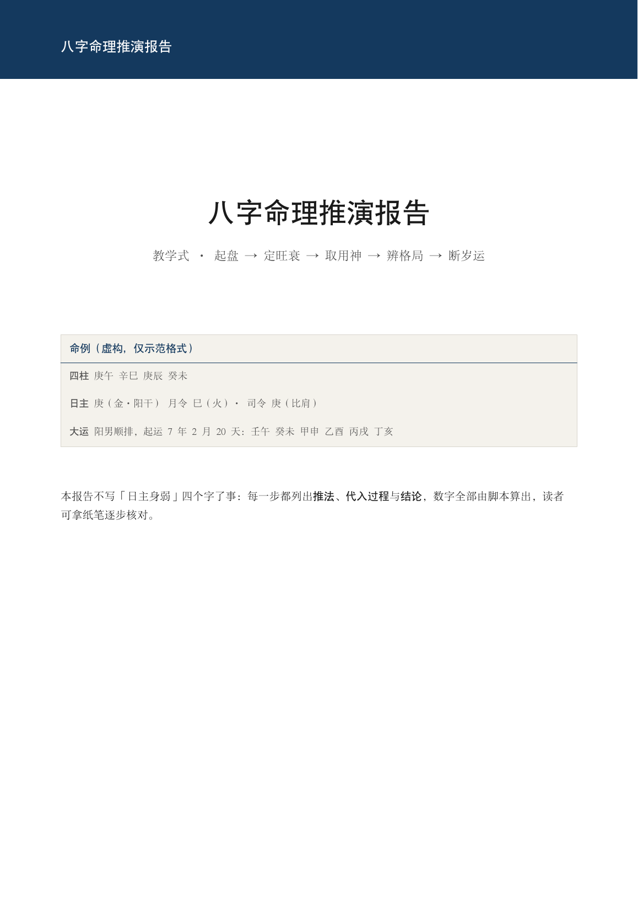
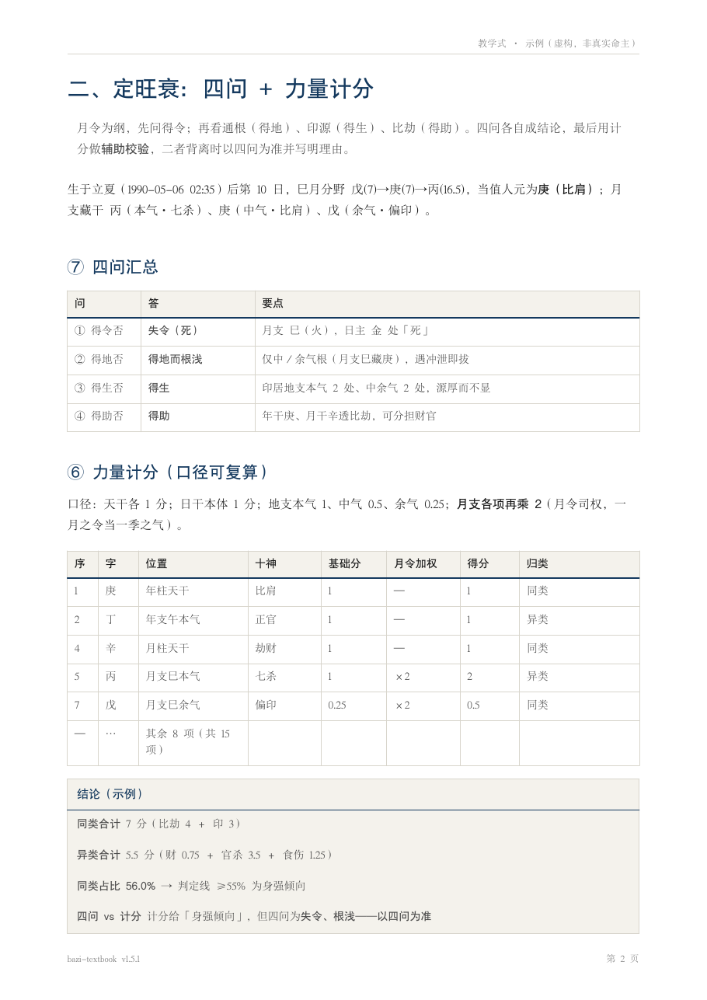

# 教科书式八字命理推演

**教你如何推演和分析八字——一步一步，每步都能复算。**

一套给 AI 智能体（Claude Code / WorkBuddy / Codex / Cursor 等支持 Agent Skills 的工具）使用的八字推演技能。
脚本负责把数算准，典籍负责给依据，报告按教材的写法把推导过程摊开给你看。

`v1.5.4` · `MIT` · **完全离线** · 简体中文

> 常见开源八字项目给你一张盘和一堆五行数字；
> 这个技能给你的是**「为什么先算这一步、这一步怎么数出来、结果怎么影响下一步」**。

> **English**: an Agent Skill for BaZi (Four Pillars) that shows its work — chart casting, strength
> scoring, structure (geju) identification and luck cycles, where every step exposes its formula and
> cites the classical source. Citations ship as a local lookup table, so it runs fully offline and
> outputs an 8–30 page PDF report. Jump to [English summary](#english).

## 报告长什么样（真实渲染，非示意图）

<p align="center">
  
  
</p>

上图由技能自带的 `scripts/pdfkit.py` 渲染，表里的分数取自 `scripts/wangshuai.js` 的实际输出——
不是设计稿，是流水线真跑出来的页面。命例为虚构示例（`1990-05-15 14:20` 男），不含任何真实命主数据。

想直接看完整版式：[**下载 3 页示例报告 `docs/sample-report.pdf`**](docs/sample-report.pdf)。

---

## 一、它跟现有方案差在哪

| 维度 | 多数开源八字项目 | 本项目 |
|---|---|---|
| 输出形态 | 排盘 JSON / 五行计数 / 网页卡片 | **8—30 页中文报告**（PDF，含表格与版式） |
| 判读能力 | 通常只排盘，不判读 | **四门并参**（格局／调候／理法／病药）＋五步推导链 |
| 依据 | 无引文，或只说「古书云」 | **典籍原文带书名·篇名**，可逐条复核 |
| 教学性 | 无 | **每步回答「推法／过程／结果」三问**，读者可照着手算核对 |
| 离线 | 常依赖在线万年历或大模型 API | **零外部知识依赖**，只有 1 个 npm 包（节气换算） |
| 数据 | 常把真人命例写进示例 | **不含任何真实命主数据**，示例均标注「虚构」 |

---

## 二、教科书式推演：五步推导链

这是本技能的核心。报告不是按「知识模块」排（盘面／十神／六亲／岁运），
而是**按推理顺序排**，且**每一步的输入就是上一步的输出**：

```
① 起盘 ──► ② 定旺衰 ──► ③ 取用神 ──► ④ 辨格局 ──► ⑤ 断岁运
  四柱        四问        四门并参      成败救应      引动链
  大运        计分        用神五档      相神定位      填实虚拱
```

每一步都必须写清三件事：

| 三问 | 含义 |
|---|---|
| **这一步在算什么** | 推法、判据、公式，让读者知道规则 |
| **本例怎么算出来的** | 逐项代入的过程，数字来自脚本，不手写 |
| **结果是什么** | 结论，并说明它如何约束下一步 |

举例（定旺衰一步）：不是写「日主身弱」四个字，而是把
**得令（旺相休囚死＋人元司令）／得地（通根）／得生（印）／得助（比劫）／克泄耗／力量计分（含口径）**
逐项列表，最后汇总成四问结论；计分与四问背离时，还要写明以谁为准、为什么。

> 判别口诀：听到「细致／全面／教学／一步步／过程／怎么推」→ 走教学式（18—30 页）；
> 只要「一份报告／结论说清楚」→ 走结论式（8—12 页）。教学式是结论式的超集。

---

## 三、典籍是内置的，不联网

技能自带两层典籍文件，**不挂任何知识库、不检索网络**也能把依据写全：

| 文件 | 内容 |
|---|---|
| `references/classics-index.md` | **重点典籍导读**：十部书的成书、体系定位、必用篇目、四门对应、判据→出处速查表、版本分歧、阅读路径 |
| `references/classics-citations.md` | **原典条文储备**：30+ 条判据的原文与出处，直接可引 |

覆盖的书架：

| 层 | 典籍 |
|---|---|
| 早期（年本·纳音） | 《李虚中命书》《玉照定真经》《珞琭子三命消息赋》《五行精纪》 |
| 集成（子平立宗） | 《渊海子平》《三命通会》《神峰通考》 |
| 精炼（四门分立） | 《滴天髓》《子平真诠》《穷通宝鉴》 |

四门与书的对应关系（本技能的判读主干）：

| 门 | 经典 | 入手处 |
|---|---|---|
| 格局 | 《子平真诠》 | 月令藏干透出 |
| 调候 | 《穷通宝鉴》 | 出生月份的气候 |
| 理法 | 《滴天髓》 | 全局气势 |
| 病药 | 《神峰通考》 | 先诊病、再下药 |

**引用纪律**：引文必标书名与篇名（如《子平真诠·论用神》）；
版本有异说的（三刑名目、人元司令日数、晚子时换日、土寄四隅）**不以名目作判据**，只写两说并存与取舍理由。

---

## 四、快速开始

### 1. 安装技能

**方式 A：命令行（推荐）**

```bash
# Claude Code
git clone https://github.com/bazilearner/bazi-textbook.git ~/.claude/skills/bazi-full-analysis

# WorkBuddy / 其他兼容目录
git clone https://github.com/bazilearner/bazi-textbook.git ~/.workbuddy/skills/bazi-full-analysis

# DeepSeek Harness（dsh）
git clone https://github.com/bazilearner/bazi-textbook.git ~/.dsh/skills/bazi-full-analysis
```

四家用的是同一套 `SKILL.md` 约定（YAML frontmatter + 同目录放 `references/`、`scripts/`），
**不需要为 dsh 单独改文件**，放对目录即可被识别。

**方式 B：手动**——下载仓库 ZIP，解压后把整个文件夹放到 `~/.claude/skills/bazi-full-analysis/`
（dsh 用户放 `~/.dsh/skills/bazi-full-analysis/`，WorkBuddy 用户放 `~/.workbuddy/skills/bazi-full-analysis/`；
目录名随意，但要保持内部结构）。

### 2. 装依赖（只需一次）

```bash
cd ~/.claude/skills/bazi-full-analysis
npm install                 # 只装 lunar-typescript，用于节气表与农历换算
pip install -r requirements.txt   # 出 PDF 才需要
```

装完之后**完全离线可用**。

> **dsh 用户注意**：dsh 是玲珑包，自带的 `node` 不一定在系统 `PATH` 里。两种解法任选——
> ① 直接用系统 node ≥18；② 用 dsh 包内的 node 跑脚本，并显式指定依赖位置：
> `export NODE_PATH="$HOME/.dsh/skills/bazi-full-analysis/node_modules"`。
> 报 `MODULE_NOT_FOUND: lunar-typescript` 就是这一条没设对，与技能本身无关。

### 3. 说人话就能用

```
帮我排一下 1990-05-15 14:20 出生的男命，按教科书方式一步步推，每步要写清怎么算的
```

```
用教学式给我出一份完整报告，要 PDF，包含定旺衰四问和辨格局成败
```

```
这是我们一家四口的出生时间，做合参，只看相互关系，不断吉凶
```

---

## 五、报告长什么样

两种交付口径，别混写成「两头不靠」：

| 样式 | 触发场景 | 篇幅 | 模板 |
|---|---|---|---|
| **结论式**（客户报告） | 要一份报告、结论说清楚 | 8—12 页 | `references/report-blueprint.md`（12 节＋3 附录） |
| **教学式**（细致式） | 要细致、全面、把全流程说清楚、像教材那样 | 18—30 页 | `references/teaching-flow.md` ＋ `detail-style.md` |

PDF 由 `scripts/pdfkit.py` 生成（reportlab，跨平台字体，支持 ttc 子字体），
`scripts/checkup.py` 负责出稿前体检：像素级版面检查（表格画到纸外、末行压页边）＋ 标记残留（`**`、`<b>`）＋ 缺字形预检。

---

## 六、目录结构

```
bazi-textbook/
├── SKILL.md                      # 技能主文件：何时用、九步工作流、已知坑、目录索引
├── references/
│   ├── classics-index.md         # 重点典籍导读（十部书·篇目·判据→出处）
│   ├── classics-citations.md     # 原典条文储备（判据 → 原文 → 出处）
│   ├── teaching-flow.md          # 教学式五步推导链的逐步规范
│   ├── detail-style.md           # 细致式章节骨架与颗粒度
│   ├── report-blueprint.md       # 结论式报告 12 节 + 3 附录
│   ├── guidance-style.md         # 白话速读／术语对照／落地动作
│   ├── judgment-core.md          # 判读内核：六层、四门、六亲、疾病、应期
│   ├── geju-chengbai.md          # 格局成败、顺逆用、相神
│   ├── relations-tables.md       # 合冲刑害会、十二长生、旬空、藏干、神煞查法、五鼠遁
│   ├── tiaohou-table.md          # 调候用神表（十干 × 十二月）
│   └── zi-shi-dayroll.md         # 晚子时换日与日界
├── scripts/
│   ├── paipan.js                 # 排盘：四柱、十神、藏干、长生、旬空、神煞、大运流年
│   ├── detail.js                 # 盘面明细：五行分栏、生克逐对、刑冲合害会逐类核
│   ├── wangshuai.js              # 定旺衰：四问 + 力量计分
│   ├── geju.js                   # 辨格局：透干对照、取格、顺逆用、成败六条
│   ├── suiyun.js                 # 断岁运：引动链、填实虚拱、逐年扫描
│   ├── tiaohou.js                # 调候查表（零依赖）
│   ├── truesolar.py              # 真太阳时与时辰边界
│   ├── family.js                 # 家庭成员合参
│   ├── pdfkit.py                 # PDF 版式
│   ├── checkup.py                # 出稿前体检
│   └── selftest.js               # 排盘口径自检（晚子时换日/五鼠遁，3360 个时刻）
├── examples/
│   ├── sample-chart.txt          # 示例输出（虚构命例）
│   └── sample-prompts.md         # 三句可直接复制的提示词
└── docs/
    ├── preview-1.png             # README 预览图：报告封面
    ├── preview-2.png             # README 预览图：定旺衰页
    ├── preview-3.png             # README 预览图：辨格局页
    ├── sample-report.pdf         # 3 页示例报告，可直接下载看效果
    └── make-preview.py           # 预览图与示例报告的生成脚本（可重跑）
```

设计原则一句话：**数字归脚本，判读归文案**。凡是脚本能算的，报告里一律不手算。

---

## 七、隐私与数据

本仓库**不含任何真实命主的信息**——出生数据、四柱、家事、健康、可定位资料一律不入库。
文档里出现的命例全部标注「示例（虚构）」，仅用于示范命令格式。

你可以自己核一遍（在仓库根目录执行）：

```bash
grep -rnE "19[0-9]{2}-[0-9]{2}-[0-9]{2}|[0-9]{2}:[0-9]{2}" --include=*.md .
grep -rnE "@[a-z0-9]+\.[a-z]{2,}|/home/[a-z]|[A-Za-z]:\\\\Users" --include=*.md .
LC_ALL=C.UTF-8 grep -rnoE "([甲乙丙丁戊己庚辛壬癸][子丑寅卯辰巳午未申酉戌亥][ 　]*){3,}" --include=*.md .
```

第三条查四柱（干支不带数字，前两条扫不到）。合规命中只有三种：显式标注「示例（虚构）」、
典籍原文（须标书名篇名）、神煞查法表里的单柱罗列。

---

## 八、边界与免责

- **适用范围**：子平法（日主体系）。不适用于紫微斗数、六爻、奇门、卦象断命——体系不同，不混用。
- **精度自述**：这类学问的准确率上限约「十之六七」（梁湘润《八字务实研究》有专章讨论）。声称百发百中的，都不可信。
- **不做的事**：不预言死亡年份、不断子女性别与数目、不断婚姻成败；健康与婚姻一律加注「民俗文化参考，以现代医学／法律／实际生活为准」。
- **性质**：传统民俗文化的研究与推演工具，**不构成任何决策依据、医疗建议或投资建议**。

---

## English

**Textbook-style BaZi (Four Pillars) analysis skill for AI agents.** Chart casting, strength scoring,
pattern (geju) identification, and luck-cycle analysis — with classical citations built in
(《子平真诠》《滴天髓》《穷通宝鉴》《神峰通考》《三命通会》《渊海子平》), fully offline after one `npm install`.
Outputs a step-by-step Chinese report (PDF) that shows *how* each conclusion was derived, not just the conclusion.

```bash
git clone https://github.com/bazilearner/bazi-textbook.git ~/.claude/skills/bazi-full-analysis
cd ~/.claude/skills/bazi-full-analysis && npm install
```

---

## License

MIT © bazi-textbook contributors
